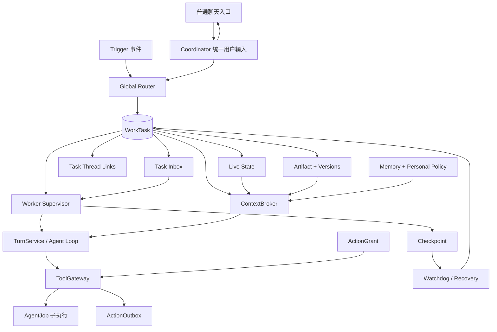

# GoldenFingerAgent SuperAgent 完整修复实施方案

> 版本：实施稿 v1.0  
> 日期：2026-11-02  
> 执行对象：后续开发子 Agent  
> 前置阅读：`AGENT.md`、`docs/架构设计与模块功能.md`、`docs/SuperAgent架构差距与模块缺陷评审.md`  
> 目标：在不推翻现有个人助理、异步队列和跨端能力的前提下，建立真正可持续、可插话、可授权、可恢复、可验收的 Task 控制面。

---

## 1. 执行原则

### 1.1 必须保持的现有行为

1. 保留现有提醒 `task` 及其 8 态状态机，不把提醒改写成工作任务。
2. 保留 `agent_job`、事件、通知、幂等、心跳、取消和 `interrupted` 语义。
3. Worker 与普通聊天继续复用 `agent.TurnService`，不得另写一套会话持久化。
4. 保留 DeepSeek Responses 默认协议、固定／动态提示分离和模型缓存策略。
5. 保留 Trigger 去重、Thread 摘要游标、渠道默认关闭和来源权限过滤。
6. 保留 `/api/events` 作为工作台统一 SSE 事件源，不新增平行事件轮询协议。
7. 中继继续只转发，不承载唯一业务状态，不改成新的任务数据库。
8. 手机端不注册电脑 `read/write/bash`，不把桌面控制面机械复制到 Android。
9. 真实数据库为 `data/gfa.db`，开发测试必须使用临时配置和临时数据库，不得直接运行根配置做冒烟。
10. 不盲目重放中断 Job，不自动重试结果未知的外部动作。

### 1.2 实施方式

- 按里程碑逐步交付，每个里程碑独立可测试、可回退，不做一次性全仓库重写。
- 新能力先通过 `work_task` 生效，旧接口用兼容适配器保留。
- 所有新表带 `owner_user_id`，所有查询和变更按 owner 过滤。
- 所有任务状态变更使用版本 CAS，禁止无条件覆盖新状态。
- 所有外部正文、工具结果和 Agent 输出继续按不可信数据处理。
- 界面只展示真实状态，不把“写入事件”展示成“Worker 已执行”。

### 1.3 本方案暂不改变的产品边界

- 不建设依赖云端的 7×24 小时中央控制面；电脑仍是工作任务持久化主节点。
- 不实现 Worker 之间自由通信。
- 不默认开放支付、凭据、权限变更等高风险操作。
- 不让普通讨论自动升级为用户确认的长期事实。
- 不承诺外部 CLI 在执行单个子进程期间一定能接收插话；不支持该能力的适配器必须声明“下一段执行生效”。

---

## 2. 目标架构与核心对象



### 2.1 对象职责

| 对象 | 生命周期 | 职责 |
|---|---|---|
| `task` | 提醒生命周期 | 现有待办、闹钟、备忘，不改语义 |
| `work_task` | 跨消息、跨执行、跨渠道 | 用户的一件持续工作 |
| `agent_job` | 一段执行 | 内部 Worker 或外部 Agent 的一次运行 |
| `chat_session` | 模型上下文 | 保存对话与 Worker 会话，不承担任务状态 |
| `agent_thread` | 来源事件流 | IM、邮件、网页、工作轨迹等连续事件 |
| `work_task_inbox` | 待消费控制／输入事件 | 用户补充、Thread 新事件和控制指令 |
| `task_live_state` | 随 Task 更新 | 当前阶段、下一步、等待条件和交接信息 |
| `artifact` | 跨版本 | 一个逻辑交付物 |
| `artifact_version` | 不可变版本 | 每次草稿、修改、验收或交付的内容 |
| `action_grant` | 有范围、可撤销、可过期 | 工具或外部动作授权 |
| `checkpoint` | 追加保存 | 安全步骤边界和恢复输入 |

**不变量：** 一个 `work_task` 可以关联多个 Thread、Session、Job 和 Artifact；同一 Task 同时最多一个 queued/running 主执行 Job。

---

## 3. 数据库修复方案

新增迁移必须按阶段拆分，禁止把所有变更塞进一个不可回退的大迁移。

### 3.1 `0011_work_tasks.sql`：长期任务与交付物

#### `work_task`

| 字段 | 类型／约束 | 说明 |
|---|---|---|
| `id` | TEXT PK | UUID |
| `owner_user_id` | TEXT NOT NULL | 所有者 |
| `title` | TEXT NOT NULL | 用户可读标题 |
| `goal` | TEXT NOT NULL | 目标，不只一句任务指令 |
| `completion_criteria` | TEXT NOT NULL DEFAULT '' | 完成与验收标准 |
| `status` | TEXT CHECK | 见第 4 节状态机 |
| `priority` | INTEGER NOT NULL DEFAULT 0 | 0～9 |
| `current_job_id` | TEXT NOT NULL DEFAULT '' | 当前／最近主执行 Job |
| `current_session_id` | TEXT NOT NULL DEFAULT '' | Worker 会话 |
| `profile` | TEXT NOT NULL DEFAULT 'read' | read/internal/external |
| `source_trigger_id` | TEXT NOT NULL DEFAULT '' | 首个来源，可空 |
| `idempotency_key` | TEXT NOT NULL | 防重复建 Task |
| `version` | INTEGER NOT NULL DEFAULT 0 | 乐观锁 |
| `created_at` / `updated_at` | DATETIME | 时间 |
| `completed_at` | DATETIME NULL | 完成时间 |

索引与约束：

- `UNIQUE(owner_user_id, idempotency_key)`。
- `(owner_user_id, status, priority DESC, updated_at)`。
- `(owner_user_id, source_trigger_id)`。
- `current_job_id` 不作为唯一任务来源，历史 Job 必须能继续保留。

#### `work_task_live_state`

- `task_id` PK，同时保存 `owner_user_id`。
- `stage`、`summary`、`next_action`。
- `waiting_kind`，默认 `none`。
- `waiting_payload_json`，默认 `{}`。
- `open_questions_json`、`confirmed_points_json`，默认 `[]`。
- `handoff_note`。
- `version`、`updated_at`。

等待类型固定为：

```text
none / user / approval / other / device / external / timer
```

#### `work_task_thread`

- `owner_user_id`、`task_id`、`thread_id`。
- `relation`：origin/related/output。
- `confidence`、`reason`、`created_by`。
- `created_at`。
- `UNIQUE(task_id, thread_id, relation)`。
- 查询 Thread 候选关联时按 owner 过滤。

#### `work_task_inbox`

| 字段 | 说明 |
|---|---|
| `id` / `owner_user_id` / `task_id` | 标识与归属 |
| `source_kind` | user/thread/control/system |
| `source_event_id` | Trigger 或外部事件 ID，可空 |
| `kind` | steer/pause/resume/cancel/recover/system |
| `body` / `payload_json` | 内容与结构化参数 |
| `priority` | 控制指令高于普通补充 |
| `status` | queued/consumed/cancelled |
| `idempotency_key` | 防重复投递 |
| `consumed_by_job_id` / `consumed_at` | 实际消费证据 |
| `created_at` | 入队时间 |

约束：

- `UNIQUE(owner_user_id, idempotency_key)`。
- `(task_id, status, priority DESC, created_at)`。
- 消费必须在一个事务内完成“写 Worker 会话用户消息＋标记 consumed”。

#### `artifact`

- `id`、`owner_user_id`、`task_id`。
- `kind`：text/document/code/analysis/email_draft/file/external_ref。
- `title`、`storage_dir`。
- `current_version`。
- `status`：draft/pending_acceptance/accepted/rejected/delivered/superseded。
- `created_by_job_id`。
- `created_at`、`updated_at`。

#### `artifact_version`

- `id`、`owner_user_id`、`artifact_id`、`version`。
- `relative_path` 或有界 `content_text`。
- `content_hash`、`mime_type`、`size_bytes`。
- `source_refs_json`。
- `change_summary`。
- `created_by_job_id`、`created_at`。
- `UNIQUE(artifact_id, version)`。

文件统一存放在数据库同目录的 `artifacts/<task_id>/<artifact_id>/`，通过 ArtifactService 生成路径，禁止模型传任意绝对路径。

#### 修改既有表

- `agent_job ADD COLUMN work_task_id TEXT NOT NULL DEFAULT ''`。
- `agent_job ADD COLUMN job_role TEXT NOT NULL DEFAULT 'primary'`，只允许 `primary/delegated`；Worker 主执行为 `primary`，ToolGateway 创建的子 Agent 执行为 `delegated`。
- `chat_session ADD COLUMN work_task_id TEXT NOT NULL DEFAULT ''`。
- `agent_action_outbox ADD COLUMN work_task_id TEXT NOT NULL DEFAULT ''`。
- 新增 `(work_task_id, created_at)` 索引。
- 仅对 `work_task_id <> '' AND job_role = 'primary' AND status IN ('queued','running')` 建部分唯一索引，保证单主执行，同时允许主 Worker 并行拥有多个子执行。

### 3.2 `0012_execution_control.sql`：检查点、授权与调用对账

#### `work_task_checkpoint`

- `id`、`owner_user_id`、`task_id`、`job_id`、`session_id`。
- `seq`、`task_version`。
- `kind`：turn_start/tool_done/waiting/turn_done/recovery。
- `summary`、`next_action`、`payload_json`。
- `created_at`。
- `UNIQUE(job_id, seq)`。

Checkpoint 不序列化模型隐藏推理，只保存可审计的恢复输入：Session、Live State、最近事件游标、已完成工具调用和下一步。

#### `action_grant`

- `id`、`owner_user_id`、`task_id`。
- `action_type`、`resource_scope_json`。
- `risk_level`：read/prepare/external_write/sensitive。
- `status`：active/revoked/expired/exhausted。
- `remaining_uses`，-1 表示任务范围内不限次数。
- `approved_by`、`approved_at`、`expires_at`、`revoked_at`。
- `version`、`created_at`、`updated_at`。

授权范围至少能限定：工具名、Agent ID、工作目录、目标渠道、目标对象和请求内容 hash。

#### `tool_invocation`

- `id`、`owner_user_id`、`task_id`、`job_id`、`session_id`。
- `tool_call_id`、`tool_name`、`risk_level`。
- `args_redacted_json`、`args_hash`。
- `grant_id`、`idempotency_key`。
- `status`：proposed/approved/running/succeeded/failed/unknown/denied/cancelled。
- `result_summary`、`effect_receipt_json`。
- `started_at`、`finished_at`。
- `UNIQUE(owner_user_id, idempotency_key)`。

敏感参数不得原样写入 `args_redacted_json`；密钥、令牌、密码、Cookie 和完整隐私正文必须脱敏。

#### 修改 ActionOutbox

增加：

- `tool_invocation_id`。
- `action_grant_id`。
- `expected_effect_json`。
- `reconciled_at`。

现有 `version` 和审批 CAS 必须保留。

### 3.3 `0013_memory_policy_devices.sql`：记忆治理与设备能力

#### `mem_edge` 增加

- `status`：inferred/confirmed/draft/conflicted。
- `scope_type`：global/task/channel/device。
- `scope_id`。
- `condition_text`。
- `confidence`。
- `version`。
- `confirmed_by`、`confirmed_at`。

旧数据默认 `inferred`，检索暂时保持可见，但上下文必须标记“待确认”。新 Worker 结论不得直接成为 confirmed。

#### `personal_policy`

- `id`、`owner_user_id`、`policy_type`：focus/preference/boundary/sop/notification。
- `name`、`content_json`、`scope_type`、`scope_id`。
- `status`：draft/active/disabled。
- `version`。
- `valid_from`、`valid_to`。
- `created_at`、`updated_at`。

#### `device_environment` 与 `device_capability`

设备表保存 owner、设备名称、类型、在线状态、最近心跳、撤销时间；能力表保存工具、资源范围、工作目录和限制。任务可通过 `work_task_device_binding` 绑定所需设备与能力。

### 3.4 旧数据迁移

仅对 `agent_id=superagent` 的既有 Job 回填 WorkTask：

- ID 使用确定性的 `legacy-<job_id>`，保证重复执行不重复建 Task。
- `goal=job.task`，`source_trigger_id=parent_trigger_id`。
- completed → completed；cancelled → cancelled；failed/timeout/interrupted → failed；queued/running → paused。
- 有 Thread 时写 `work_task_thread`。
- 有 Session 时回填 `chat_session.work_task_id`。
- 旧 completed Task 不强制改成待验收，避免迁移后产生大量虚假待办。
- 通用 CLI／BMA Job 保持独立，只有新提交显式关联 WorkTask 时才进入任务控制面。

必须增加旧库升级测试：先应用到 `0010`，插入旧数据，再执行全部新迁移两次，验证数据保留和第二次空操作。

---

## 4. WorkTask 状态机

### 4.1 状态集合

```text
draft
queued
active
waiting_user
waiting_approval
waiting_other
waiting_device
waiting_external
paused
pending_acceptance
completed
failed
cancelled
```

### 4.2 合法迁移

| 当前状态 | 允许迁移 |
|---|---|
| draft | queued、cancelled |
| queued | active、paused、cancelled、failed |
| active | waiting_*、paused、pending_acceptance、failed、cancelled |
| waiting_* | active、paused、failed、cancelled |
| paused | queued、cancelled |
| pending_acceptance | completed、active、cancelled |
| failed | queued、cancelled |
| completed | active（reopen，递增版本） |
| cancelled | 终态，不自动复活 |

规则：

1. 所有迁移使用 `expected_version` CAS。
2. waiting_* 与 `live_state.waiting_kind` 在同一事务更新。
3. 进入等待时，当前执行段正常结束并释放 Worker 槽位；新代码不再依赖 `running + waiting_kind` 长期悬挂。
4. 等待回调创建新的执行 Job，复用 Task 和 Worker Session。
5. `agent_job completed` 只表示一段执行结束，不自动表示 WorkTask completed。
6. 只有存在待验收 Artifact 或明确无文件交付的结果摘要时，才能进入 pending_acceptance。
7. 取消 Task 必须同事务取消 queued/running Job、撤销未消费 Inbox 和未执行授权。

---

## 5. Coordinator 与 Global Router 修复

### 5.1 新增 Coordinator

建议文件：`internal/superagent/coordinator.go`。

所有普通用户输入先经过 Coordinator，但保留低成本快速路径：

1. 现有 Pending 澄清、普通闲聊、提醒和记忆问答继续走主 `TurnService`。
2. 明确创建后台工作、补充现有工作、暂停／恢复／取消等工作指令进入 Router／TaskService。
3. 第一阶段不强迫每条“你好”都额外调用一次 LLM Router。
4. 手机远程指令复用同一 Coordinator，不建立另一套任务归属逻辑。

### 5.2 Router 输入扩展

为 Router 提供只读 `TaskIndex`，每个用户最多 20 个活跃候选：

- Task ID、标题、目标、状态、版本。
- 当前阶段、下一步、等待条件。
- 关联 Thread ID。
- 当前 Job ID 与执行能力。
- 最近 Artifact 摘要。

新增 Decision 字段：

- `work_task_id`。
- `confidence`。
- `association_reason`。
- 新动作：`create_task`、`update_task`、`prepare_task`、`pause_task`、`resume_task`、`cancel_task`。

兼容旧动作：`create_worker` 内部改为“创建 WorkTask＋首个 Job”；`route_to_worker` 改为“解析 Task＋写 Task Inbox”。

### 5.3 关联安全规则

- 模型只能选择 TaskIndex 中出现的 Task ID，服务端必须重新查询校验 owner 和状态。
- 禁止模型直接写任意 Worker Job ID。
- 低置信度关联进入 `ask_user`，不得强行更新旧 Task。
- 关联和撤销关联都记录原因、置信度、来源和版本。
- 新事件超出 Task 范围时取消订阅并交回 Router。
- Router 仍不持有 Bash、文件写入和外部发送工具。

---

## 6. Worker Supervisor 与真实插话

### 6.1 执行段模型

建议新增：

- `internal/superagent/supervisor.go`。
- `internal/superagent/worker_control.go`。
- `internal/worktask/`：Task、Inbox、Live State、Artifact 领域服务。

WorkerManager 继续负责并发槽、心跳、取消和 Job 生命周期；Supervisor 负责：

1. 加载 WorkTask、Live State、Context 和 Session。
2. 创建一段 `agent_job`。
3. 调用 TurnService。
4. 在安全步骤边界消费 Inbox。
5. 写 Checkpoint、Live State、Artifact 和任务状态。
6. 等待时结束执行段；回调时创建下一执行段。

### 6.2 Agent Loop 增加 BeforeStep 钩子

建议接口：

```go
type StepController interface {
    BeforeStep(ctx context.Context, s *Session, step int) ([]llm.Message, error)
}

type Runtime struct {
    // 既有字段保持
    StepController StepController
}
```

在 `internal/agent/loop.go` 每次模型请求前调用：

- 返回的新消息同时追加到 `s.Messages` 和当前 `messages`。
- 追加发生在同一个 Run goroutine，避免并发修改 Session。
- 在工具步数耗尽后的最终回答前也检查一次。
- 普通聊天 StepController 为 nil，零行为变化。
- 保留现有无工具最终回答逻辑。

### 6.3 Inbox 消费事务

WorkerStepController 消费一组消息时：

1. 校验 Job 仍是 running、Task 仍 active、版本未过期。
2. 读取 queued Inbox，控制指令优先。
3. 将 steer 内容写为 Worker Session 的 user 消息。
4. 将 Inbox 标记 consumed，记录 `consumed_by_job_id`。
5. 同一事务提交后，再把消息返回给 Agent Loop。
6. 若进程在提交后崩溃，下一段执行从持久会话恢复这些消息，不重复消费。

这样同时解决“只写日志”和“崩溃后插话丢失”。

### 6.4 暂停、取消与恢复

- pause：写入高优先级控制消息，在下一个安全步骤边界停止并保存 Checkpoint；长时间工具返回前不能假装已暂停。
- cancel：继续走现有 context cancel，同时数据库 CAS 标记取消；必须保留先读 `ctx.Err()` 再 cancel 的顺序。
- resume／recover：新建 Job，不复活旧 running Job。
- steer：返回 `202 + inbox_id + status=queued`；实际 consumed 后通过 `/api/events` 推送 `task.inbox.consumed`。
- 外部 CLI 不支持运行中输入时，Inbox 保持 queued，下一段执行生效，并在 UI 标注能力限制。

### 6.5 等待闭环

- TurnOutput.Pending 或工具返回需要用户输入时，Supervisor 将 Task 置 waiting_user。
- 高风险动作待审批时置 waiting_approval，并关联 Outbox。
- BMA／外部 Agent 等待澄清时映射为 waiting_user 或 waiting_external。
- 当前执行段保存 Checkpoint 后结束，不占用 Worker 并发槽。
- 用户答复、审批回调或外部事件到来时写 Inbox，并创建新 Job。
- 回调必须带 Task version 和 waiting version，旧回调返回 409。

---

## 7. ToolGateway 与 ActionGrant

### 7.1 工具描述

为 Registry 增加工具元数据，不改变 ToolResult 协议：

```go
type ToolDescriptor struct {
    Spec        llm.ToolSpec
    Risk        RiskLevel
    Environments []string
    RequiresGrant bool
}
```

保留现有 `NewRegistry(tools...)` 作为兼容包装，新代码可注册 Descriptor。

### 7.2 Worker Profile 的真实映射

| Profile | 默认能力 |
|---|---|
| read | 搜索、读取授权文件、查询记忆／任务、读取屏幕；禁止 write/bash/外部动作 |
| internal | read＋授权工作目录内的 write、内部记忆／任务写入；bash 和 Agent 分派按 Grant |
| external | internal＋创建外部动作草稿；真实发送、发布、共享修改仍逐次审批 |

补充规则：

- `delegate_agent` 按目标 Agent 和工作目录授权，不能因为属于 internal 就无限执行。
- 手机敏感操作继续通过 `internal/device/guard.go`，并叠加 Task Grant。
- 普通主聊天暂时保留 interactive 策略，避免所有现有对话被强制只读；自动 Worker 必须严格使用上述 Profile。
- Profile 只决定最大能力，ActionGrant 进一步缩小范围，不能扩大 Profile 上限。

### 7.3 执行门禁顺序

```text
收到 ToolCall
  → 校验 owner/task/job/session
  → 校验 Task 仍 active 且版本有效
  → 校验 Profile 允许工具
  → 校验设备与环境能力
  → 校验 Grant 范围、有效期、剩余次数和内容 hash
  → 写 tool_invocation(proposed/approved)
  → 执行
  → 写结果或 unknown
  → 需要时写 ActionOutbox／EffectReceipt
```

拒绝执行必须返回结构化错误，不得由模型自行绕过。

### 7.4 审批与撤销

- Outbox 批准后创建一次性、内容 hash 绑定的 ActionGrant。
- 修改正文、目标、渠道或资源范围后，旧 Grant 自动失效。
- Task 取消、设备撤销、Grant 到期后，未执行动作必须拒绝。
- 外部调用超时标记 `unknown`，恢复前先只读核对，禁止直接重试。
- 普通内部可逆准备可以自动执行，但应保留 Artifact 版本和审计。

---

## 8. Live State、Checkpoint 与 Watchdog

### 8.1 Live State 更新时机

- Task 创建、路由变化。
- 每个执行段开始和结束。
- 工具产生实质进展。
- 进入或退出等待。
- 新 Artifact 版本产生。
- 用户补充目标或完成标准。
- 恢复、接管、验收和重新打开。

Live State 与 Task 状态同事务更新，历史变化写 `agent_event`，不原地覆盖时间线。

### 8.2 Checkpoint 内容

至少包括：

- Task ID、Job ID、Session ID、Task version。
- 当前步骤和最近完成工具调用 ID。
- Live State 摘要和下一步。
- 已消费 Inbox 游标。
- 当前 Artifact 版本。
- 未确定副作用的 ToolInvocation ID。

恢复时从最近 Checkpoint 构造新 Turn，不尝试恢复不可序列化的模型内部推理。

### 8.3 Watchdog 第一版规则

建议新增 `internal/watchdog/`，默认 15 秒检查一次：

| 条件 | 动作 |
|---|---|
| running Job 心跳超过 90 秒 | 标记 interrupted，Task failed，通知人工 |
| 连续 3 次相同工具＋参数 hash 且无新 Artifact／状态 | 暂停 Task，记录重复循环 |
| 超过 Task 时间／步骤预算 | 暂停并请求用户决定 |
| waiting_device 的设备重新上线 | 只创建恢复候选，重新校验授权后恢复 |
| 外部动作 unknown | 保持暂停，调用只读 Reconciler |
| Watchdog 自身失败 | 记录健康事件，不伪造恢复成功 |

第一版只允许自动恢复纯只读、幂等执行；有副作用任务默认人工确认恢复。

---

## 9. ContextBroker 与记忆治理

### 9.1 ContextBroker

建议新增 `internal/agent/context_broker.go`，不要放进长期记忆模块。

Worker 上下文包括：

1. WorkTask 目标和完成标准。
2. Live State、等待条件和下一步。
3. 当前步骤所需 Thread 摘要和原文引用。
4. Artifact 索引与当前版本。
5. 按 Task 范围检索的长期记忆。
6. 生效中的 Personal Policy 和 SOP。
7. 可用工具、设备与授权限制。

建议初始预算：总量约 6000 token，其中 Task 1200、Live State 1000、Artifact 800、Memory 1500、Thread 1500；超出时保留引用并记录截断原因。

不要复用目前专用于工作轨迹的 `TurnRequest.Context` 文案。新增通用 `ContextBlocks`，旧 Context 字段保留兼容。

### 9.2 ContextReceipt

每次 Worker 执行保存：

- 来源类型和来源 ID。
- 来源版本／事件游标。
- 注入或仅引用。
- 截断原因。
- 权限范围。
- 内容 hash，不记录敏感原文。

用于回答“这次结论用了哪些资料”和后续重放。

### 9.3 记忆冲突处理

修改 `Native.applyFact`：

- inferred 不得自动让 confirmed 失效。
- 同主体／关系不同值且来源或确认等级冲突时，标记 conflicted，保留两条证据并等待用户处理。
- confirmed 的修改和作废使用 version CAS。
- Worker 自动生成内容默认 inferred 或 draft。
- 用户确认后才允许作为稳定 Personal Policy。
- 记忆检索必须带 owner 和 scope，不得通过记忆绕过原资料权限。

---

## 10. Artifact 与验收闭环

### 10.1 ArtifactService

建议新增 `internal/worktask/artifact.go`：

- `CreateDraft`。
- `AddVersion`。
- `SubmitForAcceptance`。
- `Accept`。
- `Reject`。
- `MarkDelivered`。
- `GetVersion` / `Diff`。

规则：

- 版本不可变，修改必须新增版本。
- Accept／Reject 需要 version，冲突返回 409。
- 外部发送必须引用明确 Artifact version 和 Grant。
- 文件路径由服务端生成，下载时再次校验 owner。
- 文本差异由服务端提供 unified diff；二进制只提供版本元信息和下载。

### 10.2 完成流程

```text
Worker 产生 Artifact draft
  → Supervisor 更新 Live State
  → Artifact pending_acceptance
  → WorkTask pending_acceptance
  → 用户接受：Task completed
  → 用户要求修改：写 Inbox，Task active，新增执行段
```

---

## 11. HTTP API 修复

建议新增 `internal/httpapi/work_tasks.go`，路由注册在 `server.go`。

### 11.1 Task API

```text
POST   /api/work-tasks
GET    /api/work-tasks?status=&limit=
GET    /api/work-tasks/{id}
POST   /api/work-tasks/{id}/messages
POST   /api/work-tasks/{id}/pause
POST   /api/work-tasks/{id}/resume
POST   /api/work-tasks/{id}/cancel
POST   /api/work-tasks/{id}/recover
POST   /api/work-tasks/{id}/reopen
GET    /api/work-tasks/{id}/events?after_id=
POST   /api/work-tasks/{id}/threads/{thread_id}
DELETE /api/work-tasks/{id}/threads/{thread_id}
```

所有变更请求带 `expected_version`；消息接口返回 inbox ID 和 queued 状态。

### 11.2 Artifact 与 Grant API

```text
GET    /api/work-tasks/{id}/artifacts
GET    /api/artifacts/{id}
GET    /api/artifacts/{id}/versions/{version}/download
GET    /api/artifacts/{id}/diff?from=&to=
POST   /api/artifacts/{id}/accept
POST   /api/artifacts/{id}/reject
GET    /api/work-tasks/{id}/grants
POST   /api/work-tasks/{id}/grants
DELETE /api/grants/{id}
```

### 11.3 旧接口兼容

- `/api/worker-tasks` 暂时保留，返回 WorkTask 与当前 Job 的兼容视图。
- 旧 `/steer` 解析 `job.work_task_id` 后写 Task Inbox；没有 WorkTask 的旧 Job 返回 409，不再假称已注入。
- `/api/jobs` 增加可选 `work_task_id`，用于把外部 Agent 执行挂到 Task 下。
- Worker Session 继续从 `/api/sessions` 隐藏。
- 所有状态变化写 `agent_event`，桌面通过 `/api/events` 获取更新。

---

## 12. 桌面与手机界面修复

### 12.1 立即修正语义

在完整 Inbox 上线前：

- “追加指令”暂改为“记录补充”。
- 返回提示明确“已记录，当前版本不会实时注入”。
- 完整 Inbox 上线后恢复“追加指令”，并展示 queued／consumed 两态。

### 12.2 Workbench 改造

将当前技术 Job 列表升级为 Task 视图：

- 活跃、等待、待验收、异常、完成分类。
- 显示目标、当前阶段、下一步、等待对象、当前 Profile。
- 支持追加、暂停、恢复、取消、恢复异常和重新打开。
- 展示 Artifact 列表、版本差异和验收按钮。
- 展示 Grant 的范围、到期时间和撤销。
- Job、Thread、Trigger 放入 Task 详情时间线，不作为用户主要管理对象。
- 保留任务卡返回唯一主会话的能力。

 Electron 链路必须完整修改：

```text
desktop/assistant-api.js
  → desktop/preload.js
  → desktop/main.js IPC
  → desktop/workbench.js
  → desktop/renderer.js（角标）
  → desktop/test/*
```

继续复用 `/api/events` 和现有 20 秒刷新兜底，不另建一套推送。

### 12.3 手机端

第一阶段只增加：

- 查看电脑 WorkTask 当前状态。
- 追加指令、暂停、取消和查询 Artifact 摘要。
- 明确显示“电脑未接收前，中继指令不保证持久”。

手机 Go 内核仍不启动电脑 WorkerManager，业务状态以电脑 SQLite 为准。

---

## 13. 分里程碑执行任务

每个里程碑完成后才能进入下一个，禁止并行修改同一状态机。

### M0：修正误导语义

**文件：** `desktop/workbench.js`、`internal/httpapi/superagent.go`、相关测试。

- 修改追加指令文案与 API 返回说明。
- 文档明确当前行为。
- 不改动执行逻辑。

**验收：** 界面不再宣称 Worker 已实时收到补充。

### M1：WorkTask 数据底座

**文件：** `migrations/0011_work_tasks.sql`、`internal/store/work_tasks.go`、`internal/store/repos.go`、迁移测试。

- 实现 WorkTask、Live State、Thread Link、Inbox、Artifact 表。
- 实现 owner 过滤、状态 CAS、Inbox 幂等和单活跃 Job 约束。
- 完成旧 Super-agent Job 回填。

**验收：** 旧库升级、重复迁移、并发 CAS、跨 owner 访问测试全部通过。

### M2：TaskService 与 API

**文件：** `internal/worktask/`、`internal/httpapi/work_tasks.go`、`cmd/server/main.go`。

- 实现创建、查询、状态迁移、等待、暂停、恢复、取消和 reopen。
- 实现 Task Inbox 写入与 Artifact 基础服务。
- 注册 HTTP API 和事件。

**验收：** 不使用 Worker，也能通过 API 创建 Task、补充消息、暂停和恢复，状态历史完整。

### M3：Coordinator 与 Global Router

**文件：** `internal/superagent/coordinator.go`、`llm_router.go`、`router.go`、Router 测试。

- 建立 TaskIndex。
- 普通聊天快速路径保持不变。
- 工作输入统一进入 TaskService。
- 旧 create_worker／route_to_worker 走兼容适配。
- Thread 新事件写 Task Inbox，不再只写 JobEvent。

**验收：** 新事件可正确关联候选 Task；低置信度会澄清；模型无法指定任意 Job／其他 owner Task。

### M4：Worker Supervisor、真实插话与 Checkpoint

**文件：** `migrations/0012_execution_control.sql`、`internal/agent/loop.go`、`internal/agent/runner.go`、`internal/superagent/supervisor.go`、`worker_control.go`、`worker.go`。

- 先建立 Checkpoint、ActionGrant、ToolInvocation 和 ActionOutbox 扩展的数据结构；本阶段只启用 Checkpoint，权限门禁在 M5 接线。
- 增加 BeforeStep 钩子。
- 实现事务性 Inbox 消费。
- 实现执行段、Checkpoint、等待回调和新 Job 恢复。
- 保留 TurnService 共用和现有最终回答行为。

**验收：** 第一次模型调用产生工具调用后写入 steer，第二次模型请求必须包含该 steer；进程在不同点退出不会重复消费或丢消息。

### M5：ToolGateway 与 ActionGrant

**文件：** `internal/agent/tools.go`、`internal/agent/tool_gateway.go`、`internal/superagent/`、ActionOutbox 相关代码。

- 注册工具风险与 Profile 策略。
- 实现 Grant、ToolInvocation 和执行门禁。
- 实现取消／过期／撤销后的拒绝。
- 实现 unknown 和 EffectReceipt。

**验收：** read Worker 无法 write/bash；过期 Grant 无效；修改动作内容后旧审批无效；unknown 不会自动重放。

### M6：Artifact 与桌面 Task 中心

**文件：** ArtifactService、`internal/httpapi/`、Electron 上述完整链路。

- 实现版本、差异、验收和重新打开。
- Workbench 改为 Task 视图。
- SSE 事件联动。

**验收：** 用户能创建草稿、追加版本、验收或要求修改；桌面 `npm test`、`npm run check` 通过。

### M7：Watchdog 与恢复

**文件：** `internal/watchdog/`、`cmd/server/main.go`、恢复 API。

- 实现心跳停滞、重复循环、预算和 unknown 监控。
- 实现从 Checkpoint 新建恢复 Job。
- 默认只自动恢复只读幂等任务。

**验收：** 故障注入后不丢 Task、不重复外部副作用；恢复后使用新 Job ID，旧 Job 保持 interrupted。

### M8：ContextBroker、记忆与设备治理

**文件：** `migrations/0013_memory_policy_devices.sql`、ContextBroker、Memory、Device 相关模块。

- 实现任务级上下文包和 ContextReceipt。
- 实现记忆确认、冲突和范围。
- 实现设备能力、任务绑定和 waiting_device。
- 增加 Personal Policy。

**验收：** inferred 不覆盖 confirmed；撤销设备后动作被拒绝；设备恢复需重新校验 Task 和 Grant。

### M9：评估、灰度与收尾

- 建立任务关联、插话、恢复、权限和 Artifact 验收评估集。
- 增加 Task 级模型／工具用量统计。
- 更新 `AGENT.md`、架构文档和 `.agent/progress.md`。
- 重新打包桌面版并执行 smoke test。
- 真实模型和真实 CLI 分开验收，不用单元测试冒充真机结果。

---

## 14. 必须增加的测试

### 14.1 Store 与迁移

- 0010 旧库升级到最新，数据不丢失，重复迁移为空操作。
- WorkTask 合法／非法状态迁移。
- expected_version 冲突返回 409。
- 跨 owner 查询、修改、消费和下载全部拒绝。
- 同一 Task 不能同时存在两个 queued/running 主 Job。
- Inbox 幂等提交返回原消息。
- Artifact version 唯一且不可变。

### 14.2 Worker 与并发

- BeforeStep 在每次模型请求前执行。
- steer 同时进入持久 Session 和当前 LLM messages。
- 在“消费前、消费后、模型调用前、工具返回后”注入崩溃，消息不丢且不重复。
- pause 在安全步骤边界生效，cancel 能中断当前 context。
- waiting 释放并发槽，回调创建新 Job。
- 同一 Task 多事件不会产生多个主 Worker。
- 普通聊天 StepController 为 nil 时行为不变。

### 14.3 权限与恢复

- read 不能调用 write、bash、设备写入和外部发送。
- Grant 过期、撤销、次数耗尽、资源不符、内容 hash 变化均拒绝。
- Task 取消后未执行动作失效。
- 外部工具超时产生 unknown，不自动重试。
- Watchdog 不自动恢复有副作用的未知任务。
- Checkpoint 恢复保留 Task 和 Session，但创建新 Job。

### 14.4 Router 与上下文

- 新 Task、已有 Task、跨 Task、无关联和低置信度五类样例。
- Router 只能选择 TaskIndex 候选。
- Thread 改归属后可撤销且不重复建 Task。
- ContextReceipt 记录来源版本和截断原因。
- inferred 记忆不覆盖 confirmed。
- 未授权来源不能通过 ContextBroker 或 Memory 间接注入。

### 14.5 API 与桌面

- 所有变更接口的 version CAS。
- steer 返回 queued， consumed 后产生 SSE。
- Artifact accept/reject 的版本冲突。
- Workbench 各状态与操作按钮。
- Electron API／IPC／preload 全链路测试。
- 桌面打包 smoke test。

---

## 15. 验证命令与安全要求

Go 修改至少执行：

```bash
./.bma/tools/go/bin/go.exe test ./...
./.bma/tools/go/bin/go.exe vet ./...
```

重点并发模块再执行：

```bash
./.bma/tools/go/bin/go.exe test -race ./internal/worktask ./internal/superagent ./internal/agent
```

桌面修改至少执行：

```bash
cd desktop
npm test
npm run check
```

构建与冒烟：

```bash
CGO_ENABLED=0 ./.bma/tools/go/bin/go.exe build -o server-dist/goldenfinger-server.exe ./cmd/server
npm --prefix desktop run dist
env -u ELECTRON_RUN_AS_NODE ./desktop/dist/GoldenFinger-win/GoldenFinger.exe --smoke-test
```

安全要求：

- 测试配置复制到临时目录，使用独立 `GFA_CONFIG` 和临时 SQLite。
- 不复制真实密钥到测试、文档或日志。
- 不为了测试切换真实 CC Switch 供应商。
- 不对其他项目执行真实 CLI／BMA 修改任务。
- 不用真实用户工作轨迹、微信正文或邮件作为公开测试样例。

---

## 16. 总体验收标准

只有以下闭环全部通过，才能把 SuperAgent 第一阶段标记为完成：

1. 用户创建一个 WorkTask，目标、完成标准和 Profile 持久保存。
2. Router 能将后续用户输入和另一渠道事件关联到同一 Task；不确定时澄清。
3. Worker 执行期间，用户补充能在下一个安全步骤边界进入模型上下文。
4. 暂停、取消、等待和恢复均产生真实状态变化，不只是写日志。
5. read/internal/external 对工具权限产生实际差异。
6. 高风险动作无有效 Grant 不能执行，撤销和过期真实生效。
7. Worker 产生的 Artifact 有版本，用户可验收或要求修改。
8. 进程异常后 Task 和 Live State 保留，恢复使用新 Job 且不重复副作用。
9. 另一入口能查看同一 Task 的当前状态并继续处理。
10. 从 Trigger、Router、Task、Job、Tool、Grant 到 Artifact 能形成一条完整时间线。

以下不能作为完成证据：

- 只有表和接口，没有真实执行链路。
- 只有单元测试，没有桌面端到端验证。
- API 返回 accepted，但 Worker 未消费。
- 模型声明已经审批，但 ToolGateway 未校验。
- Job completed，却没有 Task 验收状态。

---

## 17. 子 Agent 执行交付格式

每完成一个里程碑，必须提交以下信息：

1. 修改文件清单。
2. 数据迁移与兼容说明。
3. 实际运行的命令和结果。
4. 新增测试覆盖的行为。
5. 未验证项及原因。
6. 当前已知限制，不得用“应该可以”替代验证。
7. 更新后的 `.agent/progress.md`，删除或改写过期结论。
8. 下一里程碑所需的输入或人工决策。

遇到以下情况必须停止并报告，不得自行扩大范围：

- 需要直接操作真实 `data/gfa.db`，但没有备份和临时副本。
- 需要改变现有提醒 Task 的含义。
- 需要自动重放未知外部副作用。
- 需要把电脑高权限工具注册到 Android。
- 需要绕过审批、设备安全闸或渠道授权。
- 需要引入云端中央控制面或新的消息队列基础设施。
