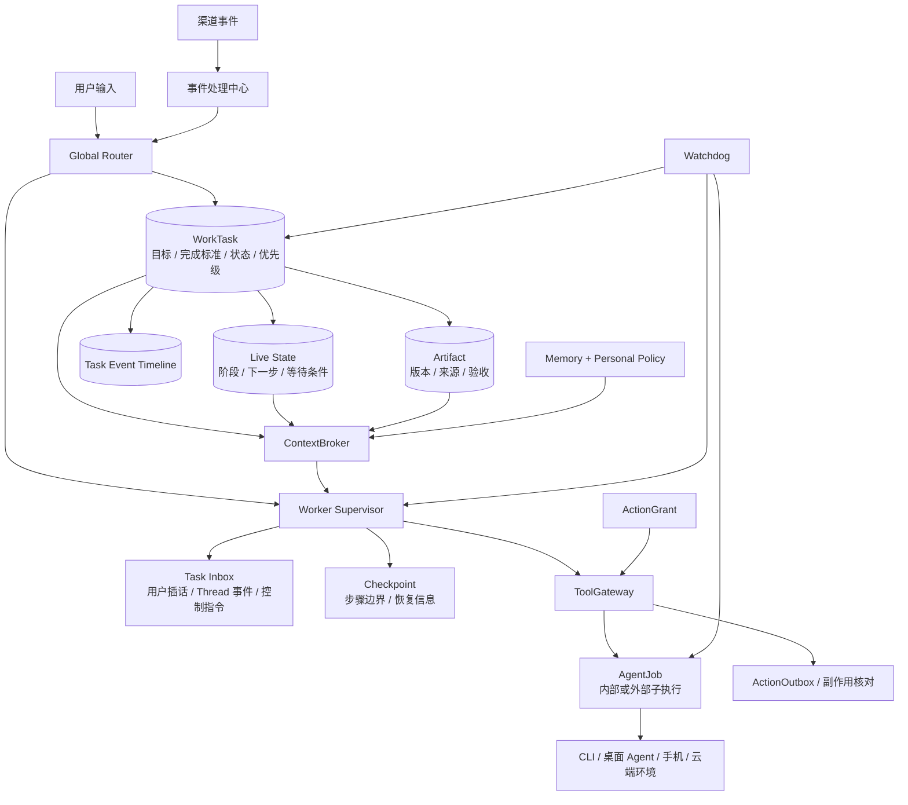

# GoldenFingerAgent 对照 SuperAgent 的架构差距与模块缺陷评审

> 评审日期：2026-11-02  
> 对照文档：`docs/references/personal-superagent-development-document.md`  
> 当前架构：`docs/架构设计与模块功能.md`  
> 评审依据：当前 Go、Electron、Android 代码与数据库迁移，不只看功能名称。

## 1. 总体结论

当前 GoldenFingerAgent 已经具备一个较好的**本机个人助理与事件执行底座**：共享 Go 内核、持久化异步队列、长期记忆、Trigger／Thread、Worker 会话、渠道开关、桌面采集和手机入口都已存在。

但如果目标是参考文档描述的 SuperAgent，当前还存在一个根本性差距：

> **当前系统是“会话＋提醒＋事件＋执行任务”，参考架构是“以持续 WorkTask 为中心的 Router＋Worker 协作系统”。**

目前最严重的不是缺少某个工具或 Agent 连接器，而是以下五个控制面尚未成立：

1. 没有面向用户长期工作的统一 Task 聚合。
2. Router 不是用户级全局协调器，只是批量 Trigger 分类器。
3. Worker 是一次性对话执行，不是可以持续接收事件、等待和恢复的运行时。
4. 工具权限、`profile` 和审批字段没有形成真正的执行前强制门禁。
5. 没有检查点、Live State、Artifact 和 Watchdog，无法完成可靠接续与验收闭环。

因此，当前可以继续做个人助理、工作记录和异步派发，但还不宜把“跨渠道持续任务”“运行中插话”“异常后自动恢复”描述为已经完整实现。

---

## 2. 现有设计中值得保留的基础

后续改造不应推倒重来，以下实现是有效基础：

| 已有能力 | 价值 |
|---|---|
| `agent_job`＋事件＋通知持久化 | 可作为 Worker 或外部 Agent 的子执行记录 |
| 提交幂等键、心跳、取消和 `interrupted` | 已具备可靠执行队列的一部分基本语义 |
| Trigger 去重、来源过滤和可信标记 | 可作为统一事件中心入口 |
| Thread 与滚动摘要游标 | 可作为跨渠道上下文组织的起点 |
| Worker 复用 `TurnService` | 避免普通聊天与后台执行形成两套模型栈 |
| 长期记忆 Episode／Edge 与来源引用 | 原始证据、时间失效和检索基础较好 |
| 渠道默认关闭、采集／摘要／Worker 分开授权 | 符合最小授权方向 |
| 电脑与手机共享 Go 领域内核 | 有利于统一任务、权限和恢复规则 |
| 外部 Agent、CLI、桌面软件和 BMA 适配 | 可继续作为 Task 下的具体执行环境 |

**核心改造方向应是补上任务控制面，而不是继续堆叠接入数量。**

---

## 3. 差距总览

优先级说明：

- **P0**：不解决就无法成立参考文档的核心闭环，或当前界面语义可能误导用户。
- **P1**：持续任务的可靠性、可维护性和安全性所必需。
- **P2**：主动策略、规模化和效果优化能力。

| 模块 | 当前状态 | 主要缺陷 | 优先级 |
|---|---|---|---|
| Task 管理 | 有提醒 `task` 和执行 `agent_job` | 缺少统一的长期工作对象 | P0 |
| Router | 有 Trigger 批量路由 | 没有全局 Task 视图，也不承接普通用户输入 | P0 |
| Worker 运行时 | 有内部 Worker 和外部 Agent 队列 | 一次性 Turn，不是持续事件循环 | P0 |
| 运行中插话 | 有 `/steer` 和 `thread_event` | 只写日志，执行器不读取 | P0 |
| 等待与恢复 | 有 `waiting_kind` 字段 | 生产流程没有完整设置、回调和恢复 | P0 |
| 工具与审批 | 有 Registry、ActionOutbox | 缺少统一 ToolGateway 和强制 ActionGrant | P0 |
| 异常恢复 | 有中断标记和心跳 | 无检查点、副作用核对和 Watchdog | P0 |
| Live State | 有结果摘要和 Thread 摘要 | 无任务级下一步、等待条件和交接状态 | P1 |
| Artifact | 有文本输出和文件工具 | 无交付物实体、版本、来源和验收状态 | P1 |
| 上下文组织 | 有历史窗口、记忆块和 Thread 摘要 | 没有按 Task／步骤统一编排上下文 | P1 |
| 长期记忆 | 有时效事实和来源 | 缺确认、适用范围、条件和并发治理 | P1 |
| 个人化规则 | 有用户类型、渠道开关和技能 | 缺 Personal Policy、SOP 版本和生效范围 | P1 |
| 执行队列 | 内部／外部复用 `agent_job` | 优先级、插话、并发和恢复语义不一致 | P1 |
| 渠道接入 | Trigger 输入较完整 | 身份映射、增量同步和输出闭环不完整 | P1 |
| 设备管理 | 有本机连接与中继 | 无设备能力注册、任务绑定和等待设备状态 | P1 |
| 主动策略 | 有自动 Worker 开关 | 无角色、价值、成本、已有负责人和反馈判断 | P2 |
| 观测与评估 | 有 EventLog、JobEvent、Trace | 缺统一 Task 时间线、成本指标和评估回放 | P1 |
| 用户终端 | 有 Workbench | 偏技术任务列表，不是 Task／审批／交付中心 | P1 |

---

## 4. P0：核心架构缺陷

### 4.1 没有真正的 WorkTask，导致所有上层能力缺少锚点

**当前实现**

- `internal/store/models.go` 的 `Task` 是提醒／备忘对象，状态为 `draft`、`scheduled`、`notified`、`done` 等。
- `migrations/0001_init.sql` 中该表围绕时间、提醒和人物关联设计。
- `agent_job` 保存一次 Agent 执行，包含目标文本、状态、输出和心跳。
- Super-agent Worker 也复用 `agent_job`，通过 `agent_id=superagent` 区分。

**缺陷**

参考文档中的 Task 应持续描述“一件工作”，但当前没有任何实体同时承载：

- 目标与完成标准。
- 当前负责人和主 Worker。
- 当前阶段与下一步。
- 等待用户、审批、他人、设备或外部服务。
- 多个 Thread 和多个来源。
- 多个执行 Session 和多次 Worker 运行。
- 交付物、验收、重新打开和任务依赖。

`agent_job.Task` 只是一段目标文本，`result_summary` 只是一次执行摘要，不能替代长期 Task。

**直接后果**

- 新邮件、新 IM 消息和新网页事件无法稳定关联到同一个用户工作对象。
- 一个工作跨多次执行后，只能看到多个 Job，不能看到统一的当前状态。
- 跨设备接续只能恢复消息或 Job 记录，不能恢复“该工作现在进行到哪一步”。

**建议边界**

新增独立的 `work_task`，不要改变现有提醒 `task` 的含义：

```text
work_task：用户级长期工作
  ├─ task_thread：一个 Task 关联多个 Thread
  ├─ task_live_state：当前阶段、下一步、等待条件
  ├─ agent_job：一次内部或外部执行
  ├─ artifact：交付物及版本
  └─ task_event：状态与决策时间线
```

现有 `agent_job` 应降级为 **Task 的执行记录**，而不是继续兼任用户 Task。

---

### 4.2 Router 缺少全局状态，无法可靠判断新旧任务

**当前实现**

`internal/superagent/llm_router.go` 的 Router 输入只有本批 Trigger 的：

- 渠道、类型和 ThreadID。
- 标题、截断正文。
- 可信等级和隐私等级。

提示词要求模型输出 `create_worker` 或 `route_to_worker`，但没有提供：

- 活跃 Task 列表。
- 各 Task 的目标、当前状态和下一步。
- 已有 Worker 与 Thread 订阅关系。
- 用户当前重点、任务依赖和优先级。
- 已有负责人或其他渠道的最新决定。

普通用户聊天则直接进入 `TurnService`，不经过这个 Router。

**缺陷**

这不是参考文档中的“用户级全局协调入口”，而是“对一批环境事件做孤立分类”。模型在不知道现有工作全貌的情况下，无法可靠选择 `worker_task_id`，也无法判断一个事件应更新旧任务还是创建新任务。

人类输入与环境事件走两套入口，还会形成两个协调中心：

- 主聊天自己决定调用什么工具。
- Super-agent Router 自己决定创建什么 Worker。

**建议边界**

Router 应同时承接 `UserMessage` 和 `Trigger`，并读取只读的 `TaskIndex`：

```text
RouteInput
  ├─ 当前输入
  ├─ 活跃 Task 摘要与版本
  ├─ Thread → Task 候选关联
  ├─ 当前 Worker／等待状态
  ├─ 用户 Personal Policy
  └─ 成本与并发预算
```

Router 只做关联、分派和协调，不直接执行高风险工具。关联结果必须带置信度、依据和可撤销历史。

---

### 4.3 Worker 是一次性 Turn，不是持续运行时

**当前实现**

`cmd/server/main.go` 的 `superAgentWorkerRunner.RunWorker` 只调用一次：

```text
TurnService.Run(Text = req.Goal, Kind = "worker")
```

`internal/superagent/worker.go` 再为这次运行设置默认 10 分钟超时。底层 Agent Loop 默认最多 6 步工具调用。

**缺陷**

参考架构中的 Worker 应持续推进 Task，并在工具执行期间接收新事件。当前 Worker 的生命周期实际是：

```text
领取 Job → 跑一次对话循环 → completed/failed/timeout
```

它不具备：

- 持续消费 Task Inbox。
- 多轮计划—执行—观察—修正。
- 跨工具调用检查点。
- 暂停、恢复和人工接管。
- 等待条件满足后的续跑。
- 根据新指令修改当前计划。
- 完成后进入待验收，而不是直接结束整个工作。

**建议边界**

引入 `WorkerSupervisor`，让一次 `agent_job` 只代表一段执行，让 `work_task` 持续存在：

```text
while task active:
    读取 Task／Live State／Checkpoint
    消费新的用户指令和 Thread 事件
    执行一个有限步骤
    保存检查点、进度和 Artifact
    根据等待条件暂停或继续
```

同一 Task 默认只有一个主写 Worker，避免共享状态被并发覆盖。

---

### 4.4 “追加指令”和 Thread 直通目前只是事件落库

**当前实现**

- `internal/httpapi/superagent.go` 的 `handleSteerWorkerTask` 只调用 `AgentJobs.AddEvent(..., "steer", ...)`，随后返回 `accepted=true`。
- `internal/superagent/worker.go` 的 `RouteToWorker` 只添加 `thread_event` 和 `worker.routed`。
- `superAgentWorkerRunner.RunWorker` 没有读取这些新增事件。
- Agent Loop 也没有在执行步骤之间消费 Worker Inbox。

**缺陷**

这是当前最明确的行为与界面语义不一致：

- UI 显示“追加指令”。
- API 返回“已接受”。
- 但正在运行的 Worker 不会因此看到指令。

`accepted` 实际只表示“事件文本写入成功”，不表示“Worker 已接收并将采纳”。

**建议**

短期应立即把 UI 和 API 返回语义改成“已记录补充，尚未注入执行”，避免误导。根本修复是建立持久化 `task_inbox`，Worker 在每个安全步骤边界读取并确认事件；高优先级停止指令应走独立控制通道，不排在普通事件之后。

---

### 4.5 等待状态目前主要是数据模型，不是完整业务闭环

**当前实现**

`agent_job` 已有 `waiting_kind`、`waiting_payload` 和 `version`，仓储提供 `SetWaiting`／`ClearWaiting`。但生产代码中主要只有定义和测试使用，未形成完整的：

- Worker 进入等待。
- 释放执行资源。
- 用户或外部回调。
- 校验等待版本。
- 重新入队。
- 从检查点继续。

**缺陷**

字段存在容易让人误以为等待审批、等待澄清和恢复已经完成，但当前主执行路径仍是一轮到终态。

**建议**

将等待原因提升到 `work_task`，执行 Job 只保存本次运行状态。至少统一支持：

```text
waiting_user / waiting_approval / waiting_other /
waiting_device / waiting_external / waiting_timer
```

恢复时必须重新检查 Task 版本、授权有效期和外部动作真实状态。

---

### 4.6 `profile` 和 `requires_approval` 没有形成强制权限控制

**当前实现**

- Router 可输出 `profile=read|internal|external`。
- WorkerManager 将 Profile 传到 `WorkerRequest`。
- `superAgentWorkerRunner.RunWorker` 没有使用 `req.Profile` 构造不同工具集。
- 普通聊天与 Worker 都通过全局 `Runtime.Registry` 获取工具。
- `RequiresApproval` 主要存在于路由决定和 ActionOutbox 数据模型中，不是通用工具执行门禁。

**缺陷**

`profile` 当前更像提示性元数据，而不是实际权限边界。声明为 `read` 的 Worker，并不会因此自动失去 `write`、`bash` 或其他工具能力。

ActionOutbox 能管理草稿和审批状态，但不能证明：

- 每个高风险工具执行前都检查了有效授权。
- 授权限定到了具体 Task、资源、动作和有效期。
- 取消 Task 后，未执行动作自动失效。
- 故障恢复时不会使用过期审批。

**建议边界**

在 Registry 前增加独立 `ToolGateway`：

```text
模型工具调用
  → 校验 Task／Worker／Device 身份
  → 校验工具风险等级与最小工具集
  → 校验 ActionGrant 范围、版本和有效期
  → 执行／创建审批／拒绝
  → 副作用核对与审计
```

`read/internal/external` 必须映射到真实工具策略，而不是只存入数据库。

---

### 4.7 恢复策略只有“安全停止”，没有“可靠继续”

**当前实现**

服务重启后，未确认结果的 running Job 会标记为 `interrupted` 并通知用户。这是正确的保守策略，但后续仍需要人工自行判断。

**缺陷**

当前没有：

- Task／步骤检查点。
- 最后一条工具调用与执行结果的强关联。
- 外部副作用是否已生效的核对器。
- 从检查点创建新执行 Job。
- 无进展、重复动作和方向偏离监控。
- 独立 Watchdog 恢复控制回路。

心跳目前主要被写入数据库，并不等同于已有完整的停滞检测与恢复。

**建议**

先保持“不确定就不重放”的原则，再增加：

1. 每个安全步骤边界写 Checkpoint。
2. 工具调用分配幂等键并保存 `unknown` 状态。
3. 恢复前调用只读核对器确认副作用。
4. Watchdog 只执行明确允许的恢复动作，其余升级人工。

---

## 5. P1：模块设计不足

### 5.1 缺少 Live State 与 Artifact，任务无法交接和验收

当前有 Thread 摘要、Worker 结果摘要和文本 Output，但它们不能替代：

**Live State 应保存**

- 已完成事项。
- 当前阶段和下一步。
- 未结束事项。
- 等待条件。
- 已确认结论与待讨论问题。
- 当前 Task 版本和交接说明。

**Artifact 应保存**

- 文件、草稿、分析结果或外部对象引用。
- 版本、来源、创建 Worker 和创建时间。
- 草稿／待验收／已交付状态。
- 内容差异与用户验收记录。

没有这两个对象，所谓“新 Worker 接手”和“用户验收”只能依赖重新阅读聊天历史。

---

### 5.2 上下文组织是分散拼接，不是任务级 ContextBroker

**当前实现**

- `PromptBuilder.BuildDynamic` 每轮注入当前时间、通用用户记忆、技能元数据和澄清状态。
- `memory.Service.BuildContext` 主要组织人物、事实和最近片段。
- Native 长期记忆主要通过搜索工具召回。
- TurnService 默认读取固定数量的近期消息。
- Worker 运行只传 Goal、Session 和 ThreadID，没有完整 Task Live State、Artifact 和来源权限编排。

**缺陷**

- 普通聊天和 Worker 使用相似的通用上下文，不随当前 Task 和步骤变化。
- Thread、Task、Worker、Artifact 之间没有统一的逐跳召回入口。
- 没有记录“本次回答实际使用了哪些关键资料”。
- 固定历史条数与固定记忆预算不能替代相关性、权限和来源优先级。
- 摘要缺少统一的原文回查协议。

**建议**

增加 `ContextBroker`，按当前 Task／步骤构造上下文包，并返回 `ContextReceipt` 记录来源、版本、权限和截断原因。长期记忆只是其中一个来源，不应与上下文组织混为一层。

---

### 5.3 原生长期记忆缺少确认、适用范围和并发治理

**当前优点**

`mem_episode` 保留证据，`mem_edge` 有来源、有效期和向量，重复事实可补来源。

**缺陷**

`mem_edge` 当前没有：

- `confirmed/inferred/draft/invalidated` 等治理状态。
- 适用 Task、渠道、设备或场景范围。
- 结论成立条件和必要背景的结构化表达。
- 用户修改、确认、作废和重新确认流程。
- 写入版本与冲突检测。
- 记忆影响过哪些 Task 的使用记录。

`applyFact` 会在同主体、同关系出现新值时令旧值失效，但没有版本或来源优先级判断。多个 Agent 同时写入时，容易形成“最后写入者让之前结论失效”，而不是可协调的冲突。

Worker 结果也会自动写入统一记忆，需要区分“用户确认事实”“Worker 生成结论”和“待讨论推断”。

**建议**

保留 Episode／Edge 基础，增加治理元数据与版本；把 Personal Policy 单独建模，不要用普通事实代替稳定规则、价值取舍和 SOP。

---

### 5.4 内部 Worker 与外部 Agent 共用表，但执行语义不统一

复用 `agent_job` 有利于统一存储，但当前两条执行链仍有明显差异：

| 行为 | Super-agent Worker | 通用 AgentHub Dispatcher |
|---|---|---|
| 并发 | 默认最多 3 个 | 单 Worker |
| 领取顺序 | `priority DESC, created_at` | 仅 `created_at` |
| 运行中追加指令 | 有 API，但只落事件 | 没有同等机制 |
| Profile | 有字段，未限制工具 | 不适用 |
| Thread／Session | 有 | 通常没有 |
| 结果进入统一记忆 | 成功后有 | 主要保存输出和通知 |
| 等待模型 | 有字段和仓储，闭环不完整 | 没有完整 Task 等待语义 |

**缺陷**

同一个“任务”在不同执行器下拥有不同能力，用户和上层 Router 很难形成一致预期。

**建议**

统一 Job 的控制协议：取消、暂停、恢复、心跳、进度、输入事件、检查点和结果回传。不同适配器可以声明能力差异，但基础语义不能同名不同义。

---

### 5.5 渠道模块偏输入，缺少完整身份与交付闭环

已有 Trigger 标准化和 ActionOutbox 是好的起点，但仍需补齐：

- 不同渠道身份到同一用户的可信映射。
- 权限撤销后停止读取和交付。
- 通用增量同步游标与断连补拉。
- 按 IM、邮件、文档和终端适配输出。
- 发送重试、`send_unknown` 核对和实际结果回报。
- 跨设备通知已读与处理状态同步。
- 一个 Task 关联多个 Thread，以及 Thread 合并、拆分和重新归属。

目前电脑端 `currentUser` 仍是 MVP 身份桩，也限制了跨渠道身份与权限模型的成立。

---

### 5.6 设备是连接端点，不是可调度执行环境

当前中继能转发命令，Android 和电脑也能提供不同工具，但缺少统一设备模型：

- 设备能力与资源描述。
- Task 对设备／工作目录／凭据的绑定。
- 设备离线时的 `waiting_device`。
- 设备重新上线后的能力重报和恢复。
- 撤销设备后使未执行命令失效。
- 设备资源、执行时间和网络范围限制。
- 交付物从设备回传到 Artifact。

此外，中继离线队列仍在内存中，不能承担参考文档所要求的持久跨设备接续。

**产品取舍需要明确：** 本机优先可以保留，但若要求“电脑关机后其他工作仍继续”，就需要一个不在该电脑上的持久控制面；仅增加中继缓存时长不能解决这个问题。

---

### 5.7 Workbench 是技术控制台，不是完整任务中心

当前 Workbench 已展示 Worker、待审批、简报和渠道，但缺少：

- 用户目标、完成标准和当前下一步。
- 活跃／等待／待验收／异常等 Task 分类。
- 暂停、恢复、接管、重新分派和优先级调整。
- 交付物版本、差异和验收。
- 授权范围、有效期和撤销。
- 记忆来源、适用范围和对当前 Task 的影响。

尤其应先修正“追加指令”的反馈语义，避免把事件写入成功展示成 Worker 已实时响应。

---

### 5.8 观测数据存在，但缺少统一评估与成本闭环

已有 `agent_event`、`agent_job_event`、通知和 Trace，但还缺少：

- 以 `work_task_id` 串联事件、路由、模型、工具、审批和交付。
- 模型用途、Token、耗时和成本的 Task 级统计。
- 任务重放与故障注入入口。
- 新旧任务关联准确率、误介入率、重复副作用等评估集。
- 用户纠正到后续评估样本的闭环。
- 提示词、Personal Policy 和主动策略的版本回退。

当前 MaxSteps 和超时只能限制单次执行，不能替代 Task 级模型、工具、时间和主动准备预算。

---

## 6. P2：主动策略与规模化缺口

当前自动 Worker 开关和 Router 是基础，但还没有参考文档中的主动策略判断：

- 用户是否是负责人，还是已有他人负责。
- 当前事项应该行动、准备、等待、记录还是忽略。
- 准备的预期价值是否高于模型和打扰成本。
- 是否只进行无副作用的草稿、检索或隔离实验。
- 低价值结果是否保持安静。
- 用户“过早、过晚、不应介入、应该继续”的反馈如何改变策略。

这些能力不应先于 Task、Worker、权限和恢复闭环建设，否则只会放大误任务、误通知和副作用风险。

---

## 7. 建议的目标模块关系



关键边界：

- **Task 是长期工作，Job 是一次执行，Session 是模型上下文。**
- **Thread 是来源事件流，不是 Task 本身。**
- **Artifact 是交付物，不是聊天回复的字符串副本。**
- **Memory 是可复用事实与经验，Live State 是当前任务状态。**
- **ActionOutbox 是发件与审批记录，ToolGateway 才是统一执行门禁。**

---

## 8. 建议改造顺序

### 第一阶段：先建立真实的最小任务闭环

1. 新增 `work_task`、`task_live_state`、`task_thread`、`artifact` 和统一时间线。
2. 保留原提醒 `task`，避免概念继续混淆。
3. 让普通用户输入和 Trigger 都进入 Global Router。
4. 建立 Task Index 和新旧任务关联记录。
5. 做一个 Task 对应一个主 Worker 的隔离执行。
6. 建立 Task Inbox，让追加指令真正在安全步骤边界生效。
7. 将 Worker 完成改为“产生交付物，Task 待验收”。

### 第二阶段：补齐控制与恢复

1. 实现暂停、恢复、取消、接管和等待回调。
2. 在步骤边界写 Checkpoint。
3. 建立 ToolGateway 与 ActionGrant，真正执行 Profile 和审批策略。
4. 增加副作用核对、`send_unknown` 和恢复前检查。
5. 增加 Watchdog 的无进展、重复动作和超时监控。

### 第三阶段：完善上下文、个人化与跨设备

1. 建立 ContextBroker 和 ContextReceipt。
2. 为长期记忆增加确认、范围、条件和版本冲突处理。
3. 独立建设 Personal Policy 与 SOP 版本。
4. 建立设备能力、Task 绑定和等待设备恢复。
5. 完善渠道输出、通知同步和 Artifact 中心。

### 第四阶段：再扩大主动策略与多 Agent 协作

1. 主动准备价值／成本评估。
2. 用户反馈与主动策略版本化。
3. 评估集、故障注入和成本看板。
4. 更复杂的多 Worker 与团队 Agent 协作。

---

## 9. 最先应该修正的三个具体点

如果只做下一轮小范围修改，建议按此顺序：

1. **修正插话语义**：明确当前 `/steer` 只是记录事件，随后实现 Worker Inbox 的真实消费。
2. **建立 WorkTask**：把提醒 Task 与执行 Job 从概念和数据模型上分开，形成长期工作锚点。
3. **让 Profile 真正限制工具**：Worker 按 Task／Profile 获取最小工具集，高风险动作统一经过 ToolGateway。

这三项分别解决“行为是否真实”“持续工作是否有锚点”“自主执行是否有边界”，比继续增加 Agent 类型或扩大主动采集更优先。
