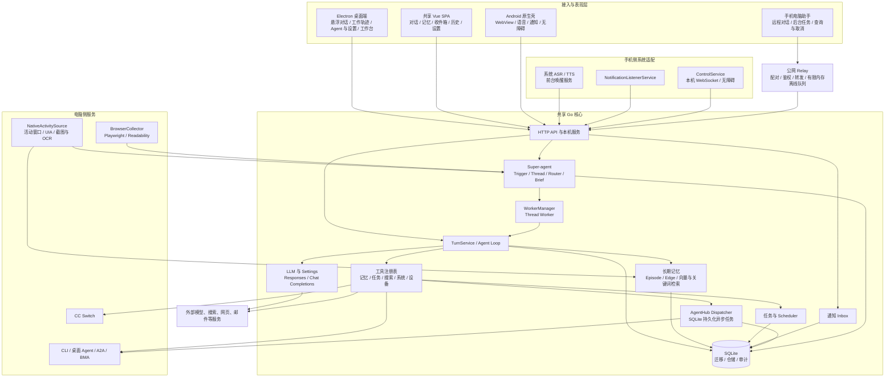

# GoldenFingerAgent 架构设计与模块功能

> 文档性质：当前实现架构说明，不是重构方案或功能承诺清单。  
> 更新日期：2026-11-02  
> 梳理依据：当前 Go、Electron、Android、Web 源码，以及 `AGENT.md`。部分早期 README 描述已经滞后，发生冲突时以当前代码装配为准。

## 1. 项目定位

GoldenFingerAgent（金手指管家）是一个**本机优先、跨电脑与手机、能够记录个人上下文并调用其他 Agent 的个人 AI 管家**。

当前系统已经不只是桌面聊天挂件，而是由四类核心能力组成：

1. **个人助理**：对话、长期记忆、人物画像、备忘、任务、提醒、通知线索和每日简报。
2. **电脑协作**：工作轨迹采集、阶段总结、文件与命令工具、网页采集，以及其他 Agent 的异步调度。
3. **手机随身入口**：共享 Go 内核、语音唤醒、系统通知读取、无障碍设备控制，以及通过中继远程指挥电脑。
4. **事件驱动的 Super-agent**：把邮件、社交通知、网页、工作轨迹等外部事件整理为 Trigger、Thread 和 Worker 任务。

整体设计采用“**共享 Go 领域内核＋各平台系统适配器＋共享 Web UI**”的路线。平台层负责语音、通知、无障碍、桌面窗口和截图等系统能力；身份、对话、记忆、任务、调度和安全规则尽量放在 Go 内核中，避免各端重复实现业务逻辑。

---

## 2. 总体架构



### 2.1 运行形态与部署入口

| 形态 | 启动与装配入口 | 核心职责 | 与电脑完整版的差异 |
|---|---|---|---|
| 电脑服务 | `cmd/server/main.go` | 完整 HTTP 服务、Agent 工具、记忆、调度、Super-agent、邮件、简报和中继 | 功能最完整，是主要业务装配入口 |
| 电脑桌面 | `desktop/`、`desktop/server-manager.js` | 启动并守护 Go 服务，提供悬浮球、独立轨迹窗、管理窗、托盘和桌面采集 | Electron 不替代 Go 业务内核 |
| Android | `android/gosvc/gosvc.go`、`android/app/` | gomobile 内嵌 Go 服务，原生层提供 ASR/TTS、通知、无障碍和前台保活 | 未装配电脑系统工具、AgentHub、Super-agent、Skills、IMAP 和每日简报等完整电脑能力 |
| 公网中继 | `cmd/relay/`、`internal/relay/` | 手机与电脑配对、消息转发和短时离线排队 | 不运行 Agent，不是持久化任务数据库 |

Android 的 Go 服务仅监听 `127.0.0.1` 随机端口，并通过随机 token 保护本机请求；数据放在 App 私有目录。电脑端由 Electron 负责 Go 子服务生命周期。

---

## 3. 代码分层与目录职责

| 目录 | 主要职责 |
|---|---|
| `cmd/server` | 电脑完整版服务装配与后台任务启动 |
| `cmd/relay` | 独立公网中继进程 |
| `android/gosvc` | Android 共享内核的独立装配与移动入口 |
| `internal/httpapi` | HTTP 路由、请求校验、静态页面、上传、SSE/Outbox 等接口层 |
| `internal/agent` | 对话循环、工具协议、系统提示、TurnService、系统与技能工具 |
| `internal/llm` | 模型抽象及 OpenAI 兼容协议实现 |
| `internal/settings` | `settings.json` 持久化、模型方案和热加载 |
| `internal/memory` | 人物事实、原生长期记忆和记忆检索 |
| `internal/task`、`internal/scheduler` | 任务状态机、时间调度、提醒升级与周期任务 |
| `internal/nlu`、`internal/intent` | 时间/事实抽取、置信度与澄清、常驻事件提醒 |
| `internal/inbox` | 通知去重、线索、稍后处理、watch 与检索 |
| `internal/voice` | 唤醒词和语音指令状态机 |
| `internal/device` | 手机设备连接、动作执行、安全门禁和急停 |
| `internal/agenthub` | Agent 发现、CLI/桌面/A2A/BMA 调用、CC Switch、异步任务 |
| `internal/superagent` | 事件接入、路由、滚动摘要、Worker、每日简报和网页规则 |
| `internal/relay` | 中继协议、配对、转发、去重和离线队列 |
| `internal/store` | SQLite 连接、事务、仓储与数据模型 |
| `internal/compliance` | 儿童保护、监护人同意、事实策略和审计 |
| `internal/extsvc` | 天气、搜索、抓取、ASR/TTS、推送、短信等外部接口 |
| `migrations` | 版本化 SQLite 迁移 |
| `web` | 电脑与手机共享的 Vue 单页应用 |
| `desktop` | Electron 主进程、preload、各窗口及桌面采集实现 |
| `android/app` | Kotlin/Android 系统能力与原生壳 |
| `skills` | 按需加载的本机 Markdown 操作技能 |

---

## 4. 接入层与共享 Web 应用

### 4.1 HTTP API

**关键代码：** `internal/httpapi/`、`cmd/server/main.go`

HTTP 层承担：

- 对话、会话历史、附件上传与静态资源服务。
- 人物、事实、任务、提醒和记忆档案导出。
- 通知 Inbox、语音状态机、设备控制和模型设置接口。
- Agent 列表、异步任务 `/api/jobs*`、Super-agent、渠道和简报接口。
- 中继管理和本机事件 Outbox。

电脑端 `currentUser` 仍是 MVP 身份桩，默认取首个用户，不能把整个本机 HTTP 服务视为已经具备完整多用户认证、可直接暴露公网的服务。中继管理端点另有本机限制。

### 4.2 共享 Vue SPA

**关键代码：** `web/index.html`

共享页面包含：

- 主对话、Markdown 回复、工具处理轨迹、快捷指令和任务卡片。
- 图片/视频附件展示与上传。
- 记忆面板：人物、事实、任务、事件提醒、遗忘和 Markdown 导出。
- 收件箱：语义/关键词搜索、稍后处理、线索和等待中的通知。
- 对话历史：按日期查看历史会话并返回主会话。
- 手机“电脑助手”：配对、远程对话、后台任务、事件续看、取消和幂等重试。
- 设置：显示模式、主题、模型方案、搜索密钥、六类受控渠道及全局开关。
- 今日简报展示。

当前附件进入 Agent 时主要是把**本地路径附加到提示词**，并非已经把图片或视频编码成标准多模态模型输入。

---

## 5. 对话运行时与模型层

### 5.1 Agent Loop 与 TurnService

**关键代码：** `internal/agent/loop.go`、`internal/agent/runner.go`、`internal/agent/prompt.go`

- Agent Loop 默认最多执行 **6 步工具调用**；工具步数耗尽后，会额外进行一次无工具回答，尽量给出最终结论。
- 系统提示分为固定规则与动态上下文，动态内容包括用户、记忆和技能元数据。
- 工具结果被标记为“数据而非指令”，降低网页、文件和工具文本对系统指令的污染风险。
- `TurnService` 统一处理 HTTP 聊天与后台 Worker 的会话准备、执行和持久化。
- 普通聊天使用单主会话；Worker 会话带 `kind=worker` 和 `thread_id`，与主对话隔离。
- NLU 澄清状态保存在 `chat_session.state_json`，默认有效期 10 分钟，服务重启后仍可继续处理。

### 5.2 LLM 与设置

**关键代码：** `internal/llm/openai/`、`internal/settings/`、`settings.json`

- 同时支持 **Responses** 和 **Chat Completions**，默认采用 Responses。
- 模型配置支持多方案、当前方案切换、Base URL、模型名、协议、密钥、推理强度、上下文和输出预算。
- 设置采用原子写入；外部修改 JSON 后，读取时可按文件变化热加载。
- Embedder 与对话模型分离，用于长期记忆和通知语义检索。
- 联网搜索和网页抓取通过统一外部服务接口接入，当前主要使用 DeepSeek 官方网页能力。

---

## 6. 工具体系、NLU 与常驻意图

### 6.1 工具分组

工具通过统一 `Tool` / `ToolSpec` / `ToolResult` 协议注册，电脑端在 `cmd/server/main.go` 组合。

| 工具组 | 代表能力 | 关键代码 |
|---|---|---|
| 日期与任务 | `get_datetime`、`create_task`、`set_alarm`、`update_task`、`list_tasks` | `internal/agent/tools_impl.go` |
| 记忆与人物 | `save_note`、`save_fact`、`query_person`、`search_memory`、`forget_memory` | 同上 |
| 常驻意图 | `create_intent`、`list_intents`、`cancel_intent` | 同上 |
| 网络与天气 | `web_search`、`web_fetch`、`get_weather` | 同上 |
| 手机控制 | `screen_observe`、`tap`、`input_text`、`swipe`、`back`、`open_app`、`wait` | 同上 |
| 电脑系统 | `read`、`write`、`bash` | `internal/agent/system_tools.go` |
| 技能 | `list_skills`、`load_skill` | `internal/agent/skill_tools.go` |
| Agent 管理 | `list_agents`、`refresh_agents`、`open_agent`、`agent_provider_usage`、`switch_claude_provider` | `internal/agenthub/tools.go` |
| 异步 Agent 任务 | `delegate_agent`、`list_agent_tasks`、`get_agent_task`、`cancel_agent_task` | `internal/agenthub/async_tools.go` |

电脑端最后用 `AsyncTools` 覆盖同步 `delegate_agent`，因此实际模型看到的是**提交后立即返回 task_id 的异步派发**。

### 6.2 NLU 与确定性门控

**关键代码：** `internal/nlu/`、`internal/nlu/timecn/`

- 中文时间优先走规则解析，失败后使用 LLM 回退并校验。
- 任务创建综合模型自报置信度、时间解析、人物消歧等证据进行门控：自动创建、澄清或丢弃。
- 缺时间、人物歧义和事实确认使用冻结的 PendingAction，不依赖模型自行记住上一轮假设。
- 评价性内容不允许自动写成人物事实；儿童账号另有事实类型限制。

### 6.3 常驻意图

**关键代码：** `internal/intent/service.go`

“当某件事出现时提醒我”采用确定性的 OR-of-AND 关键词组匹配，不在匹配路径调用模型。具有触发次数预算、冷却、过期和显式取消规则，避免普通对话意外取消长期约定。

### 6.4 技能池

**关键代码：** `internal/skill/skill.go`

启动时扫描 `skills/<name>/SKILL.md`，提示词只注入名称和描述；模型需要具体流程时调用 `load_skill` 读取正文，减少技能池对上下文的持续占用。

---

## 7. 长期记忆与人物画像

**关键代码：** `internal/memory/native.go`、`internal/memory/`、`migrations/0006_longterm_memory.sql`

当前唯一长期记忆后端是项目内的原生实现，`LongTermMemory` 接口保留后续替换空间。

### 7.1 写入

1. 原始证据先写入 `mem_episode`，通过 `source_id` 幂等，避免同一事件重复入库。
2. 后台调用 LLM 从 Episode 抽取事实到 `mem_edge`。
3. 抽取失败最多重试 3 次；即使失败，原始证据仍保留。
4. 相同事实补充来源，不重复制造等价边。
5. 同主体、同关系出现新值时，旧值通过 `valid_to` 失效，保留历史而不是直接覆盖。
6. 用户遗忘支持真正删除，不只对检索隐藏。

### 7.2 检索

- 融合向量、关键词和时间有效性。
- 对主体进行一跳关系扩展，补充相关人物或事实。
- 向量不可用时可以退化为关键词路径。
- 对话记忆、人物画像、任务提醒与工作轨迹总结共享持久化底座，但数据模型和用途不同。

---

## 8. 任务、提醒与通知 Inbox

### 8.1 任务状态机与调度

**关键代码：** `internal/task/`、`internal/scheduler/`

- 任务采用 8 态状态机，区分待确认、已安排、完成、取消等生命周期。
- Scheduler 基于 SQLite 持久化 tick，不依赖单次 HTTP 请求存活。
- 支持免打扰、提醒升级、预算、周期任务和每日盘点。
- App 内提醒通过内存 `httpapi.Outbox` 推送给在线客户端。
- 推送、短信、天气在当前装配中仍有 stub，不能把接口存在等同于真实外部服务已经接通。

### 8.2 通知 Inbox

**关键代码：** `internal/inbox/`、Android `NotifyListenerService`

- 对通知去重并保存原始标题、正文、来源和时间。
- 提取取件码、地址等线索，支持 snooze 和关键词 watch。
- 检索优先使用向量，向量化失败时明确降级关键词。
- 通知捕获本身不调用 LLM，降低每条通知的成本和延迟。
- Android 旁路上报通知，不取消用户原通知；可支持社交通知转述和稍后处理。

---

## 9. 语音与手机设备控制

### 9.1 语音状态机

**关键代码：** `internal/voice/`、Android `MemoryCaptureService`

Go 内核负责业务判定，默认规则包括：

- 唤醒词“小金小金”。
- 10 秒指令窗口。
- 4 秒语音片段合并。
- 30 秒上下文窗口。
- 输出 `speak`、`chat`、`capture` 等动作。

Kotlin 负责系统 ASR/TTS、前台服务和通知，不再各自维护一套唤醒业务规则。

### 9.2 无障碍控制

**关键代码：** `internal/device/`、Android `ControlService`、`DeviceClient`

- Go Agent 通过 `screen_observe` 获取当前节点树，再决定点击、输入、滑动、返回或打开应用。
- Android 通过本机 WebSocket 执行动作并上报屏幕。
- `internal/device/guard.go` 负责敏感词、敏感包名、人工确认和 10 秒急停。
- Kotlin 只保留确认 UI 与本地硬急停，避免安全规则只存在于模型提示中。

---

## 10. AgentHub 与持久化异步任务

### 10.1 Agent 发现与调用

**关键代码：** `internal/agenthub/manager.go`、`internal/agenthub/`

当前目录和适配器覆盖：

- CLI：Claude Code、Pi、ChatGPT、Hermes、DeepSeek Harness、Kimi Code 等。
- 桌面软件：KimiWork、WorkBuddy、Qoder 等。
- 特殊 Agent：BMA。
- 外部协议：A2A。
- 供应商管理：CC Switch。

CLI 采用安装入口扫描与命令探测结合的方式；桌面 Agent 与 CLI 分类管理。桌面软件可打开或唤起，CLI 通过命令执行。BMA 另有原生 API、澄清和计划确认处理。CC Switch 可读取额度/供应商信息，并在明确确认后切换 Claude Code 供应商，接口不向模型返回密钥。

### 10.2 异步 Dispatcher

**关键代码：** `internal/agenthub/async.go`、`internal/agenthub/async_tools.go`

- 提交任务时先写入 SQLite，再立即返回 `task_id`，不在一次聊天或 HTTP 请求中同步等待长任务。
- 使用 `agent_job`、`agent_job_event`、`agent_notification` 保存状态、事件和可靠通知。
- 支持幂等提交、列表、详情、取消、心跳和未读通知。
- 当前为单 Worker 执行模型。
- 服务重启后，遗留 running 任务标记为 `interrupted`，不会在副作用未知时盲目自动重跑。
- 手机可通过中继提交长任务，并重新连接后查询或取消。

这套队列与 Super-agent 的 WorkerManager 是两套不同机制：前者调度外部 Agent，后者执行内部 Thread Worker。

---

## 11. Super-agent 事件系统

**关键代码：** `internal/superagent/`、`migrations/0007_superagent.sql`、`migrations/0009_channels_briefs.sql`

### 11.1 事件模型

- **Trigger**：外部事件的标准输入，包含渠道、来源、类型、正文、去重键、隐私级别和可信标记。
- **Thread**：同一对话、网页、活动主题等事件的上下文容器。
- **EventLog**：记录接入、路由、Worker 和状态变化，便于追踪。
- **Router**：决定忽略、通知、创建 Worker 或记录到既有 Thread。
- **ActionOutbox**：外部动作的审批与状态模型。
- **Summarizer**：维护 Thread 滚动摘要，避免每次重新喂入全部原始事件。
- **BriefGenerator**：按版本生成每日简报，并校验来源引用。

### 11.2 开关与降级

- 六类受控渠道默认关闭：工作轨迹、邮件、飞书、钉钉、电脑微信、手机微信。
- 网页渠道另有按站点配置的采集、摘要和自动 Worker 开关。
- 采集、摘要、索引、简报、自动 Worker 分离控制。
- 后台模型 Router 默认关闭，需要 `GFA_SUPERAGENT=1`，同时还受用户全局开关控制。
- 模型路由失败时回退到确定性通知，不因为模型不可用而丢失事件。
- `OnNotify` 当前负责桌面/内部 Outbox 通知，不代表已经发送到外部社交渠道。

### 11.3 WorkerManager

**关键代码：** `internal/superagent/worker.go`

- 消费 `agent_id=superagent` 的 Thread Worker。
- 复用 `agent.TurnService`，因此 Worker 与普通聊天共享模型、工具和持久化机制。
- 默认最多 3 个并发 Worker。
- 绑定 WorkTask 时由 Supervisor 创建/恢复执行段：`SetActive → ContextBroker → TurnService(StepController) → Checkpoint → pending_acceptance/waiting/failed`。
- 执行期间的新事件和用户补充写入 `work_task_inbox`；`BeforeStep` 在每次模型请求前事务性消费并写入 Worker 会话，进程崩溃不丢不重。
- Pause 在安全步骤边界停止并释放槽位；Resume/Recover 创建新 Job，旧 Job 不复活。

### 11.4 感知采集层

- **统一信封**：`desktop/observation-envelope.js` 统一 `event_id/source_id/observed_at/occurred_at/completeness/content_hash/change`；真实发送时间未知时 `occurred_at=null`。
- **持久 Spool**：`desktop/observation-spool.js` 先写本地队列再投递；2xx 确认、202/4xx 丢弃正文保留原因、5xx/网络错误指数退避；重启恢复 pending。
- **微信连接器**：`desktop/wechat-db-connector.js` 独立于工作轨迹，监督 `cmd/wechat-db-connector` 生成的 Go 只读连接器。`internal/wechatdb` 负责 Windows 进程取钥、SQLCipher 页解密、WAL 合并和 modernc SQLite 查询，读取本机微信 4.x 数据库；按稳定 `source_id=wechat-db:<account_key>:<chat_key>` 逐会话授权，按 `<account_key>:<chat>:<shard>:<local_id>` 生成确定性 `event_id`。首版 `latest_only`，不读微信 UI、不发送、不 hook/注入、不写原始库；无 Python 运行时。
- **网页采集**：`BrowserCollector` 持久化调度和页面检查点；正文无变化不重复上传，变化区分 new/updated；桌面启动即恢复调度，只有存在启用站点才加载 Playwright。
- **工作 Episode**：观察事件带 `contextKey`；协作总结按上下文/空闲间隔/最大时长拆分 Episode，分别进入 `activity:project:*`/`activity:web:*`/`activity:unassigned:*` Thread；Episode 上报走同一 Spool。
- **可观测性**：工作台「接入设置 → 感知采集状态」显示授权会话数、最近读库/新消息/入库、待发/过滤/失败和错误；`wechat-db:list-chats` 与 `wechat-db:test` 只做会话列表/预览、不写 Spool。模型通过 `get_connector_health/list_wechat_chats/read_wechat_messages/search_wechat_messages` 只读已入库数据；联系人消息在确定性路由层硬阻断 Task/Worker 创建。

### 11.5 WorkTask 控制面

**关键代码：** `internal/worktask/`、`migrations/0011_work_tasks.sql`、`0012_execution_control.sql`、`internal/watchdog/`

- **对象分离**：提醒 `task` 仍是闹钟/待办；`work_task` 是跨消息、执行段、渠道的持续工作。`agent_job` 是一次执行段，`artifact` 是交付物，`action_grant` 是授权。
- **状态机**：`draft → queued → active → waiting_* / paused / pending_acceptance → completed`；`failed` 可重排队，`cancelled` 终态。所有迁移带 `expected_version` CAS。
- **Inbox**：用户补充、Thread 新事件和控制指令统一入队；控制指令优先。消费事务同时写 Worker 会话用户消息、标记 consumed、写事件。
- **Artifact**：版本不可变，路径由服务端生成在数据库目录 `artifacts/<task>/<artifact>/`；验收/拒绝带版本 CAS，所有待验收版本通过后 Task 才完成。
- **ActionGrant / ToolGateway**：Profile 决定能力上限，Grant 再限定工具、资源、次数、有效期和内容 hash。`tool_invocation` 记录 proposed/running/succeeded/failed/unknown/denied，参数脱敏；unknown 不自动重试。
- **Checkpoint / Watchdog**：Checkpoint 只保存可审计恢复输入；Watchdog 90s 心跳停滞、重复工具循环、24h 预算和 unknown 副作用监控。默认只自动恢复只读任务，有副作用任务人工确认。
- **ContextBroker**：按 Task 范围注入目标、Live State、Artifact 索引、Thread 摘要、任务级记忆和 Personal Policy；约 6000 token 预算，记录 ContextReceipt 与截断原因。
- **Coordinator**：明确的 `/task ...` 或中文任务指令低成本进入 TaskService；普通聊天仍走主会话快速路径。

### 11.4 外部动作边界

ActionOutbox 的审批和状态数据模型已经存在，但当前电脑总装配中未看到真实外部渠道发送器的完整接线。因此，“已记录待审批动作”不等于“邮件、微信等外部消息已经成功发送”。

---

## 12. 电脑工作轨迹与协作模式

**关键代码：** `desktop/activity-trail.js`、`desktop/native-activity-source.js`、`desktop/collaboration.js`

### 12.1 采集主链路

- 主数据源是自研 `NativeActivitySource`，采集活动窗口、UIA、页面正文、截图与 OCR。
- 重点从“打开了哪个应用、点了哪里”转向“当前页面实际展示了什么内容”。
- 通过内容变化和去重减少鼠标移动、静止页面和重复额度区域的无效记录。
- Screenpipe 仅作为默认关闭的影子评估，不是当前唯一或默认主采集器。

### 12.2 展示与持久化

- 工作轨迹是独立半透明桌面窗口，不与主聊天窗口的最小化生命周期绑定。
- 每 2 秒进行一次观察。
- 事件和阶段总结写入 JSONL；UI 展示最近 300 条，启动恢复最近 5000 条。
- 截图在总结后进入保留与清理流程，默认保留 3 天，不作为无限增长的长期记忆原文库。

### 12.3 总结与回忆

- 协作模式默认每 15 分钟形成阶段总结。
- 总结可写入长期记忆，同时进入 Super-agent 的 activity Thread。
- 主聊天并非每轮都注入全部轨迹；只有工作总结、回顾类问题才通过 `/api/summarize` 使用压缩后的上下文。

---

## 13. 网页、邮件与渠道采集

### 13.1 网页采集

**关键代码：** `desktop/browser-collector.js`、`internal/superagent/web.go`

- 使用 Playwright 与 Readability 提取当前授权页面正文。
- 支持人工登录，凭据使用 Electron safeStorage 加密。
- URL 规范化后按 origin 和路径前缀校验授权范围。
- 页面内容按不可信数据处理，不允许页面正文覆盖系统指令。
- 网页内容 hash 和规范化 URL 用于去重与稳定标识。

### 13.2 邮件

**关键代码：** `cmd/server/main.go`、`internal/settings/`、IMAP 相关装配

电脑完整版包含 IMAP 轮询装配，将邮件转换为 Super-agent 事件；Android 独立装配不包含该能力。账号和轮询配置来自服务端设置。

---

## 14. Electron 桌面端

**关键代码：** `desktop/main.js`、`desktop/preload.js`、`desktop/server-manager.js`

桌面主进程负责：

- 启动、停止和守护 Go 服务。
- 主对话悬浮球、独立工作轨迹窗、Agent/设置管理窗、CC Switch、Workbench 和托盘。
- 通过 preload 的 IPC 白名单向渲染层暴露能力，避免网页直接拥有完整 Node 权限。
- 协作开关、工作轨迹显示、透明度及桌面采集配置。
- Workbench 展示待审批、后台 Worker、简报、渠道和网页采集状态；同时使用 SSE 刷新与 20 秒轮询兜底。

桌面窗口是系统接入层，不直接替代 Go 的记忆、任务和 Agent 业务逻辑。

---

## 15. Android 端

**关键代码：** `android/app/`、`android/gosvc/gosvc.go`

| 组件 | 功能 |
|---|---|
| `MainActivity` | 加载本机 WebView 和共享 SPA |
| `GoBridge` | 管理 gomobile AAR 服务及本机连接信息 |
| `GoForegroundService` | 前台保活并轮询本机 Outbox |
| `MemoryCaptureService` | 系统 ASR/TTS、语音采集和前台通知 |
| `NotifyListenerService` | 通知旁路上报、社交通知转述和稍后处理 |
| `ControlService` / `DeviceClient` | 本机 WebSocket、屏幕节点上报和无障碍动作 |
| 原生确认与急停 UI | 对敏感设备操作保留系统层人工控制 |

当前基线为 minSdk 26、target/compileSdk 34，Java/Kotlin 17。

---

## 16. 手机—电脑中继

**关键代码：** `cmd/relay/`、`internal/relay/`、桌面与 Android relay client

### 16.1 协议与能力

- 使用 WebSocket 传递 `command` / `result`。
- 中继为 `channel`、`from`、`to` 盖章，客户端不能伪造路由身份。
- 消息 ID 双端去重。
- 支持普通聊天、异步长任务提交、任务查询和取消。
- 离线指令可短时排队，重连后投递；手机 UI 支持幂等重试。

### 16.2 当前边界

- 默认每通道每方向最多 200 条离线消息。
- 离线消息 TTL 默认 24 小时，去重窗口默认 10 分钟，配对码有效期 5 分钟。
- 配对关系和离线队列都在中继内存中，中继重启会丢失未投递消息。
- 电脑只有配置 `GFA_RELAY_URL` 后才启用中继接收器。
- 生产部署必须使用 TLS；该中继不是可替代 SQLite 的持久任务队列。

---

## 17. 数据存储与迁移

**关键代码：** `internal/store/`、`migrations/`

数据库使用 `modernc.org/sqlite`，`store.Repos` 聚合各业务仓储，并通过迁移逐步演进。

| 迁移分组 | 主要内容 |
|---|---|
| `0001`～`0003` | 用户、会话、消息、人物、事实、任务、审计、索引和常驻意图 |
| `0004` | 通知 Inbox、线索、snooze、watch 与检索数据 |
| `0005` | AgentJob、任务事件和任务通知 |
| `0006` | 原生长期记忆 Episode、Edge、向量和来源 |
| `0007` | Super-agent Trigger、Thread、Event、Worker、ActionOutbox |
| `0008` | 普通聊天单主会话约束 |
| `0009` | 渠道、每日简报及相关数据 |
| `0010` | 渠道与全局功能开关 |

文件型数据还包括：

- `settings.json`：模型、搜索、中继、IMAP、网页站点等配置。
- `agents.json`：Agent 发现和保存信息。
- 工作轨迹 JSONL：桌面活动事件与阶段总结。
- 上传目录：聊天附件。
- 截图临时保留目录：协作模式截图及清理流程。

---

## 18. 关键数据流

### 18.1 普通对话

```text
Web / Electron / Android / 中继
  → HTTP 或 TurnService
  → 会话与 PendingAction 准备
  → 固定系统提示＋动态用户/记忆/技能上下文
  → LLM
  → 工具调用（0～6 步）
  → 无工具最终回答
  → 消息、卡片、Trace 持久化并返回客户端
```

### 18.2 长期记忆

```text
对话、备忘或工作轨迹总结
  → mem_episode 原始证据（source_id 幂等）
  → 后台 LLM 抽取
  → mem_edge 新事实 / 补充来源 / 旧值时间失效
  → 向量＋关键词＋有效时间检索
  → 后续对话按需召回
```

### 18.3 创建提醒

```text
用户自然语言
  → create_task / set_alarm
  → 人物消歧与中文时间解析
  → 置信度门控：自动创建 / 澄清 / 丢弃
  → 任务状态机与 SQLite
  → Scheduler 到点
  → 本机 Outbox / 已接入的外部通知通道
```

### 18.4 工作轨迹总结

```text
活动窗口＋UIA＋正文＋截图/OCR
  → 内容变化检测与去重
  → 独立轨迹窗口和 JSONL
  → 默认 15 分钟阶段总结
  → 长期记忆＋Super-agent activity Thread
  → 工作总结类提问时按需召回
```

### 18.5 异步 Agent 任务

```text
delegate_agent / 手机远程指令
  → agent_job 先落库并返回 task_id
  → Dispatcher 单 Worker
  → CLI / 桌面 Agent / A2A / BMA
  → 状态事件、结果和通知落库
  → 客户端查询、续看或取消
```

### 18.6 Super-agent 事件

```text
邮件 / 通知 / 网页 / 工作轨迹
  → 渠道与来源开关过滤
  → Trigger 去重和 Thread 映射
  → EventLog
  → 确定性路由或可选模型 Router
  → 通知 / 滚动摘要 / Worker / 每日简报
```

### 18.7 手机远程电脑任务

```text
Android 电脑助手
  → 中继配对与 WebSocket command
  → 内存离线排队（电脑不在线时）
  → 电脑 relay client
  → 普通 TurnService 或 AgentHub Dispatcher
  → result / task_id / 后续查询与取消
```

### 18.8 手机敏感操作

```text
模型提出设备动作
  → screen_observe 核对当前节点
  → device Guard 检查敏感词、包名和确认要求
  → 必要时 Android 人工确认
  → 本机 WebSocket 执行
  → 结果返回；确认窗口内可硬急停
```

---

## 19. 安全边界与降级策略

| 领域 | 当前机制 |
|---|---|
| 工具与网页内容 | 明确作为不可信数据，不赋予系统指令地位 |
| 电脑系统工具 | 通过受控工具注册表暴露，而不是让模型直接持有进程权限 |
| 手机敏感操作 | Go 安全门禁＋Android 人工确认＋本地硬急停 |
| 外部发送 | ActionOutbox 审批模型；实际发送器需单独核对接线 |
| 渠道隐私 | 默认关闭受控渠道，采集、摘要、索引、简报、Worker 分开授权 |
| 网页授权 | origin／路径白名单、URL 规范化、safeStorage 凭据保护 |
| 儿童与人物事实 | 监护人同意、内容过滤、评价性事实禁止自动写入 |
| 记忆删除 | 支持真删除和遗忘级联 |
| 模型不可用 | Super-agent 可回退确定性通知；原始记忆 Episode 保留 |
| 向量不可用 | Inbox 和记忆可退化关键词检索 |
| 长任务中断 | 任务保留并标记 interrupted，不盲目自动重放 |
| 中继身份 | 服务端覆盖路由字段，双端消息去重，配对码短期有效 |

配置方面应继续遵循：**不要把明文密钥提交到仓库或复制进文档和日志**；现有本地配置中的敏感值宜逐步迁移到环境变量或系统加密存储。

---

## 20. 当前限制与验收边界

以下是当前代码中需要明确保留的边界，不应在功能介绍中省略：

1. **电脑 HTTP 身份仍是 MVP 桩**，不是完整公网多用户认证体系。
2. **中继离线队列是内存实现**，重启会丢未投递消息；后续规模扩大时可接外部队列，但当前不是 SocketMQ 等持久消息系统。
3. **AgentHub 当前是单 Worker**，不是多任务并行调度集群。
4. **WorkTask 运行中事件已进入 Inbox 并在安全步骤边界消费**；但外部 CLI 不支持运行中输入时只能下一段生效，且尚未做真实模型长任务端到端验收。
5. **ActionOutbox 不等于真实外部发送已完成**，外部渠道 sender 仍需按目标渠道接线和验收。
6. **附件目前不是完整多模态协议输入**，主要传递本地路径供工具处理。
7. **天气、推送、短信等存在 stub**，需要真实供应商配置和联调。
8. **儿童内容过滤仍含关键词桩**，不能替代成熟内容审核服务。
9. **Android 与电脑完整版能力不对等**，手机远程电脑是补足电脑 Agent 能力的主要路径。
10. **本文是静态源码架构核对**，没有据此宣称所有模型、CLI、桌面软件、Android 真机、邮件和公网中继组合均已在当前环境完成端到端验收。

---

## 21. 架构结论

GoldenFingerAgent 当前的核心不是某个单一聊天窗口，而是一个以 SQLite 和 Go 领域服务为中心的本地个人 Agent 运行时：

- 用 **TurnService＋工具注册表**统一对话和执行。
- 用 **Episode＋Edge**保存可回溯、可更新、可遗忘的长期记忆。
- 用 **AgentHub Dispatcher**可靠调用电脑上的其他 Agent。
- 用 **Super-agent Trigger／Thread／Worker**承接持续发生的外部事件。
- 用 **Electron 与 Android 原生适配器**获得桌面和手机系统能力。
- 用 **共享 SPA＋中继**形成随身入口和跨端任务入口。

后续扩展应优先延续这些边界：平台能力放适配器、业务状态放 Go 内核、长任务走持久化队列、外部内容保持不可信、敏感动作保留人工确认。
